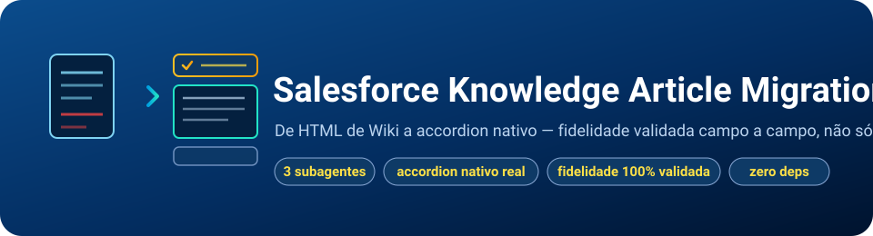

<p align="center">
  
</p>

<p align="center">
  
  
  
  
</p>

# Salesforce Knowledge Article Migration

Skill agêntica e autônoma para migrar artigos de Knowledge Base em HTML
(exportados de um Wiki, um `.zip` por artigo) para o formato de importação
do Salesforce Knowledge — preservando a estrutura rica do conteúdo original
(accordion, abas, emoji, caixas de aviso), não apenas o texto.

## Por que esta skill existe

A conversão ingênua de um HTML de Wiki para Salesforce Knowledge tende a
cometer dois erros opostos: ou trunca conteúdo real (regex gulosa que para
no primeiro `</div>` interno, descartando até 80% de um artigo com painéis
aninhados), ou preserva o texto mas acha o visual todo — um artigo que era
interativo no Wiki de origem (acordeão, abas) vira parágrafos estáticos
empilhados no Salesforce. Esta skill nasceu de uma migração real de 16
artigos onde os dois problemas aconteceram, foram diagnosticados e
corrigidos — e o que sobrou é encapsulado aqui como pipeline repetível.

## Como funciona, em 3 etapas orquestradas

| Etapa | Subagente | Faz | Nunca faz |
|---|---|---|---|
| 1. Inventário | `kb-inventory-mapper` | Extrai os ZIPs de origem e mapeia 100% do conteúdo (painéis, imagens, links, listas por artigo) em `manifest.json` — a baseline de fidelidade | Não converte nada |
| 2. Conversão | `kb-converter` | Roda o parser mecânico (estrutura HTML, deriva título/slug) e **lê cada artigo gerado para escrever Summary e Question__c de verdade** | Nunca gera Summary/Question por heurística de truncamento |
| 3. Validação | `kb-fidelity-validator` | Reconfere fidelidade de forma independente (sem o viés de quem converteu) e devolve problemas específicos por artigo | Não corrige nada sozinho — só reporta |

Se a validação encontrar um problema, o orquestrador volta à etapa exata
que falhou — nunca reconverte o lote inteiro às cegas — até a validação
sair limpa ou um circuit-breaker (3 tentativas no mesmo artigo) levar a
decisão para um humano.

## O que ela nunca faz, em nenhuma etapa

- Nunca gera Summary/Question__c por script — é sempre leitura e autoria
  real de um agente, nunca truncamento ou template.
- Nunca aceita um artigo convertido sem comparar contagem de ``/
  `<a href>`/`<ul>` contra o artigo original.
- Nunca empacota o ZIP final com qualquer placeholder não substituído.
- Nunca supõe nome de campo, Record Type Id ou nome de grupo de categoria —
  confirma contra o schema real da org antes de gerar qualquer CSV.
- Nunca tenta "corrigir" uma referência de imagem já quebrada na fonte
  original inventando uma URL.

## Pré-requisitos

- **Node.js**, qualquer versão recente.
- `unzip` (ou equivalente) para extrair ZIPs de origem e validar o pacote
  final.
- Acesso de leitura (schema/SOQL) à org Salesforce de destino, para
  confirmar o Record Type Id e o nome do grupo de categoria de dados antes
  de qualquer conversão.
- Pelo menos um `.zip` de artigo de origem — ou use o artigo de exemplo
  embutido (`assets/example-source/`) para testar sem dados reais.

## Como começar

### Instalação

```bash
git clone https://github.com/brunotrolo-bank/Salesforce_KnowledgeArticle_Migration.git
cd Salesforce_KnowledgeArticle_Migration
```

Nenhuma dependência para instalar — os scripts em
`.claude/skills/sf-knowledge-migrate/scripts/` são Node.js puro
(`zlib` da standard library para empacotar ZIP, sem `npm install`).

### Antes de usar contra artigos reais

Rode o pipeline contra o artigo de exemplo embutido (fictício, não precisa
de dados de cliente) para validar que o ambiente está correto:

```bash
cd .claude/skills/sf-knowledge-migrate
node scripts/package-zip.js --source assets/example-source/00a1b2c3d4e5f60718293a4b5c6d7e8f9012345-exemplo-politica-de-garantia-estendida --out /tmp/demo-zips/exemplo.zip
node scripts/extract-zips.js --source /tmp/demo-zips --out /tmp/demo-extracted
node scripts/convert.js --source /tmp/demo-extracted --out /tmp/demo-convertido --record-type-id <Id de 15 chars de teste>
node scripts/validate.js --manifest /tmp/demo-extracted/../manifest.json --converted /tmp/demo-convertido
```

### Uso

No Claude Code, dentro do repositório:

```
/sf-knowledge-migrate
```

Informe (ou deixe o agente perguntar): a pasta com os `.zip` de origem, o
Record Type Id de 15 caracteres da org de destino, e o nome do grupo de
categoria de dados. A skill cuida do resto sozinha — inventário, conversão,
validação em loop, empacotamento — e entrega o `.zip` pronto para
Setup > Knowledge > Import Articles.

## Garantias de qualidade aplicadas em cada etapa

| Risco | Onde é bloqueado |
|---|---|
| Painel de acordeão truncado (regex gulosa parando no primeiro `</div>`) | Parser por profundidade de tags em `convert.js` — nunca regex de linha única |
| Título de painel não detectado (markup do original varia) | Critério por `<h4 class="panel-title">`, não por um `id` específico do link interno |
| `RecordTypeId` com formato errado (18 chars em vez de 15) | `convert.js` recusa rodar; `validate.js` reconfere no CSV final |
| `RecordTypeId` ausente (erro silencioso do Import Wizard) | `convert.js` exige o parâmetro; `validate.js` bloqueia CSV sem a coluna |
| Summary/Question gerados por heurística fraca | Placeholders detectáveis (`__TODO_...`) que falham a validação se sobreviverem |
| Contagem de ``/`<a href>`/`<ul>` divergente do original | `validate.js` compara contra `manifest.json` artigo por artigo |

## Histórico de correções aplicadas (de uma migração real)

| Rodada | Problema encontrado | Correção |
|---|---|---|
| 1 | Regex gulosa truncava painéis com `<div>` aninhado, perdendo até 80% do conteúdo | Parser por profundidade de tags |
| 2 | Header de coluna com capitalização errada (`QUESTION__c` vs. `Question__c`) rejeitado pelo Import Wizard | Regra de API name exata documentada e aplicada |
| 3 | `RecordTypeId` ausente do CSV não gerava erro, só deixava o campo em branco | Parâmetro obrigatório + checagem em `validate.js` |
| 4 | `RecordTypeId` de 18 caracteres rejeitado ("not a lookup ID") | Validação de comprimento (15 chars) em `convert.js` |
| 5 | Critério de título de painel (`id="component-title_link"`) só cobria 5 de 16 artigos reais — o resto virava conteúdo sem accordion | Critério trocado para `<h4 class="panel-title">`, robusto às duas variações observadas |
| 6 | Accordions gerados sem respiro visual (título colado no corpo, um colado no outro) | `style` inline de margem no `<details>`/`<summary>` |
| 7 | Caixa de aviso do original (fundo amarelo) virava `<div>` sem nenhuma cor | `background-color` inline, reproduzindo o destaque visual |

## Resumo — entrada, o que faz, o que entrega

| | |
|---|---|
| **Entrada** | Pasta com `.zip` de artigos HTML exportados de um Wiki |
| **O que faz** | Extrai, estrutura (accordion/abas/emoji/alerta nativos), autora Summary/Question, valida fidelidade em loop |
| **Entrega** | `.zip` pronto para Setup > Knowledge > Import Articles, com relatório de conversão e lista de avisos conhecidos (ex.: imagem já quebrada na fonte) |

## Relacionado

- [Salesforce_Deep_Debugger](https://github.com/brunotrolo-bank/Salesforce_Deep_Debugger) — diagnóstico de bugs em produção com evidência (5 Porquês), do mesmo autor.
